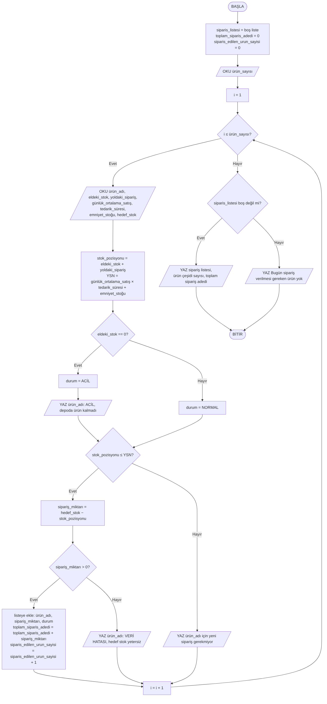

# Haftalık Ödev 1 — Stok Yeniden Sipariş Kontrolü

*Günlük Hayattan Bir Problemin Algoritması ve Akış Şeması*

## 1. Problem tanımı

Küçük bir toptancının deposunda her gün sonunda hangi ürünlerin tedarikçiden yeniden sipariş edileceğine karar verilmesi gerekmektedir. Her ürün için girdiler; eldeki stok, yoldaki (verilmiş ama gelmemiş) sipariş miktarı, günlük ortalama satış, tedarik süresi (gün), emniyet stoğu ve hedef stok seviyesidir. Her ürünün stok pozisyonu (eldeki + yoldaki) hesaplanır ve yeniden sipariş noktasıyla (günlük satış × tedarik süresi + emniyet stoğu) karşılaştırılır. Stok pozisyonu bu noktaya eşit veya altındaysa, stoğu hedef seviyeye tamamlayacak miktarda sipariş önerilir. Çıktı; sipariş edilecek ürünlerin miktar ve aciliyet bilgisiyle listesi, sipariş verilen ürün çeşidi sayısı ve toplam sipariş adedidir.

Neden yoldaki sipariş de sayılıyor: Günlük satışı 20, tedarik süresi 5 gün ve emniyet stoğu 30 olan bir üründe YSN 130'dur. Elde 100 adet varken yolda 200 adet geliyorsa stok pozisyonu 300'dür ve yeni sipariş gerekmez. Yoldaki sipariş göz ardı edilirse, mal gelene kadar her akşam aynı ürün için yeniden sipariş verilir.

| Girdi (her ürün için) | İşlem | Çıktı |
|---|---|---|
| Eldeki stok, yoldaki sipariş, günlük ortalama satış, tedarik süresi, emniyet stoğu, hedef stok | Stok pozisyonu = eldeki + yoldaki · YSN = günlük satış × tedarik süresi + emniyet stoğu · Pozisyon ≤ YSN ise sipariş = hedef stok − pozisyon | Sipariş listesi (ürün, miktar, durum) · sipariş verilen ürün çeşidi sayısı · toplam sipariş adedi · ACİL ve VERİ HATASI uyarıları |

## 2. Sözde kod

Algoritma her ürün için stok pozisyonunu yeniden sipariş noktasıyla karşılaştırır; bir döngü ve dört koşul yapısı içerir.

```
BAŞLA
    siparis_listesi = []
    toplam_siparis_adedi = 0
    siparis_edilen_urun_sayisi = 0
    OKU ürün_sayısı
    HER ürün İÇİN (1'den ürün_sayısı'na kadar):
        OKU ürün_adı
        OKU eldeki_stok
        OKU yoldaki_sipariş
        OKU günlük_ortalama_satış
        OKU tedarik_süresi
        OKU emniyet_stoğu
        OKU hedef_stok
        stok_pozisyonu = eldeki_stok + yoldaki_sipariş
        yeniden_sipariş_noktası =
            (günlük_ortalama_satış * tedarik_süresi) + emniyet_stoğu
        EĞER eldeki_stok == 0 İSE:
            durum = "ACİL"
            YAZ ürün_adı, " ACİL: Depoda ürün kalmadı."
        DEĞİLSE:
            durum = "NORMAL"
        EĞER SONU
        EĞER stok_pozisyonu <= yeniden_sipariş_noktası İSE:
            sipariş_miktarı = hedef_stok - stok_pozisyonu
            EĞER sipariş_miktarı > 0 İSE:
                siparis_listesi'ne (ürün_adı, sipariş_miktarı, durum) ekle
                toplam_siparis_adedi = toplam_siparis_adedi + sipariş_miktarı
                siparis_edilen_urun_sayisi = siparis_edilen_urun_sayisi + 1
            DEĞİLSE:
                YAZ ürün_adı, " VERİ HATASI: Hedef stok seviyesi yetersiz."
            EĞER SONU
        DEĞİLSE:
            YAZ ürün_adı, " için yeni sipariş gerekmiyor."
        EĞER SONU
    DÖNGÜ SONU
    EĞER siparis_listesi boş değil İSE:
        YAZ "Sipariş listesi:", siparis_listesi
        YAZ "Sipariş verilecek ürün çeşidi sayısı:", siparis_edilen_urun_sayisi
        YAZ "Toplam sipariş adedi:", toplam_siparis_adedi
    DEĞİLSE:
        YAZ "Bugün sipariş verilmesi gereken ürün bulunmamaktadır."
    EĞER SONU
BİTİR
```

## 3. Akış şeması



Şema sözde kodun birebir karşılığıdır; 5 karar kutusunun her birinin Evet ve Hayır çıkışı vardır. Mermaid ile üretilmiştir. Kullanılan standart semboller: oval = başla/bitir, dikdörtgen = işlem, eşkenar dörtgen = karar, paralelkenar = girdi/çıktı.

Sözde koddaki "HER ürün İÇİN" döngüsü, akış şemasında bir sayaçla gösterilmiştir (i = 1 → i ≤ ürün_sayısı? → i = i + 1). Mantık aynıdır; bu gösterim döngünün nerede başlayıp nerede bittiğini görünür kılar.

Akış şeması teslim edilen PDF raporundan alınmıştır. YZ ile karşılaştırma, prompt günlüğü ve YZ kullanım beyanı bu repoda değil, yalnızca teslim edilen PDF raporunda yer almaktadır.
